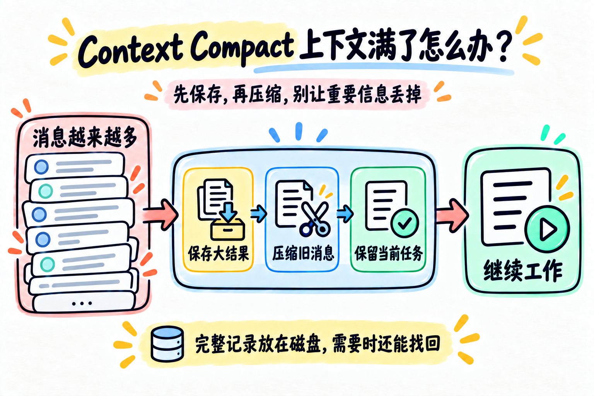

# 第 08 章：Context Compact —— 上下文满了怎么办？



> **一句话总结：模型读过的大结果先存盘、只留预览，旧消息再按条数裁掉；两步做完还超限，才把旧历史交给模型写成摘要。**

面试里如果只回答“做摘要”，还没有说明信息怎么恢复、摘要会丢什么。本章的示例在每次请求模型之前，按信息损失从小到大做三件事。

## 三步各有各的触发条件

| 步骤 | 什么时候触发 | 做什么 | 代价 |
| --- | --- | --- | --- |
| 1. 外置大结果 | 单条 `tool` 结果超过 4000 字符，而且模型已经读过 | 原文写进 `.task_outputs/`，上下文里换成路径和 300 字符预览 | 原文还在，但模型要再调一次 `read_file` 才看得到 |
| 2. 裁剪旧消息 | 消息超过 6 条（开头 3 条 + 最近 3 条），而且中间有整组消息可以移出 | 留下开头和最近几条，中间换成一条标记 | 被裁掉的消息模型看不到了，原文只在 transcript 里 |
| 3. 总结旧历史 | 前两步做完，整个请求估算仍超过 10000 字符 | 另发一次请求，把模型读过的历史写成一条摘要 | 多一次请求；摘要有损，不能当证据 |

三个数分别是 `LARGE_RESULT_CHAR_LIMIT`、`KEEP_RECENT_MESSAGES` 和 `CONTEXT_CHAR_LIMIT`。它们是教学阈值，故意调得很小，好让一个短任务就能看到三步。第 3 步的大小是 JSON 序列化后的字符数，只是估算，不是模型真实的 token 上限。

对照图看：前两格是第 1、2 步，“保留当前任务”是第 3 步里单独留下的用户请求，底下那行“完整记录放在磁盘”对应 transcript。

## 两条贯穿三步的规则

**最新一轮工具结果，谁也不动。** 工具刚返回的内容模型还没读过。这时就换成预览，模型永远看不到后半截。所以代码先找到最后一条 `assistant` 消息，它后面的 `tool` 结果原样送出，三步都只处理它前面的部分：

```python
def fresh_start(messages: list[dict]) -> int:
    """Index of the newest assistant message; tool results after it are still unread."""
    for index in range(len(messages) - 1, -1, -1):
        if messages[index].get("role") == "assistant":
            return index
    return len(messages)
```

**原始消息另记一份。** 每产生一条消息，`append_transcript()` 就往 `.transcripts/transcript-xxxx.jsonl` 追加一行，写的是它最初的样子。上下文里的消息后来怎么换预览、怎么裁、怎么摘要，都不会改到这个文件。

三步的顺序在 `prepare_context()` 里（这里省略了打印）：

```python
messages = persist_large_results(messages)      # step 1
messages = snip_history(messages, transcript)   # step 2
size = estimate_chars(messages)
if size > CONTEXT_CHAR_LIMIT and fresh_start(messages) > 2:
    messages = compact_history(messages, active_request, transcript)  # step 3
```

`fresh_start(messages) > 2` 的意思是：最新一轮之前如果只有 system 和用户请求，就没有东西可总结，不必白发一次请求。裁剪时还会避开断点，一条带 `tool_calls` 的 `assistant` 消息和它的 `tool` 结果要么一起留，要么一起走。

## 跟一次运行走一遍

任务是依次读第 00～05 章的 README。模型先列目录，再一章一章读。下面是几次关键请求之前发生的事：

| 请求 | 触发 | 发生了什么 | 送出的估算大小 |
| --- | --- | --- | --- |
| 第 4 次 | 无 | 第 00 章约 2200 字符，不到 4000，留着。第 01 章约 5400 字符，刚读回来，原样送出 | 约 9600 |
| 第 5 次 | 1、2 | 第 01 章模型读过了，换成预览。消息到了 10 条，移出最早那组“读第 00 章” | 约 14700 → 7000 |
| 第 7 次 | 2、3 | 裁完还有约 10400：第 03 章不够大，没被外置，再加上刚读回来的第 04 章。旧历史写成一条摘要，第 04 章原样保留 | 约 11100 → 6400 |

跑完后，`.task_outputs/tool-results/` 里有 3 个文件（第 01、02、04 章的原文），transcript 有 17 行。

这些数字来自离线模拟：用脚本扮演模型，没有调用真实模型。真实模型的读法不同，结果就不同：

- 模型一轮把 6 个文件全读回来，三步都不会触发，因为最新一轮不能动。
- 摘要来得早，历史变成一条，消息条数重新累计，这次运行里可能就看不到裁剪。
- 读的全是长文件，每条读过就被外置，剩下的很小，摘要可能一直不出现。

## 存下来的东西怎么读回来

**外置的结果。** 预览那条消息里带着保存路径。模型需要细节时调用 `read_file(path, offset, limit)`：`offset` 是起始行号，一次最多 200 行，没读完时末尾会提示下一页从哪一行开始。重读回来的内容不会再另存一份；它之后被移出上下文时，仍然指回原来的文件。

**transcript。** 裁剪标记和摘要里都带着它的路径。它主要给人和程序查原文；模型也能用 `read_file` 读，但一行就是一条完整消息，可能很长。它只是这一次运行的原始记录，不会自动变成跨会话的记忆，那是第 09 章的事。

`read_file` 仍然拒绝 `.env`、`.git` 这类隐藏路径，只放行示例自己写入的这两个目录。

**摘要里留了什么。** `compact_history()` 把当前用户请求 `active_request` 单独留下，再附上摘要和 transcript 路径。送去总结的只是模型读过的最近一段历史（最多约 8000 字符）。未完成的事项全靠摘要归纳，代码没有单独保存，可能漏掉；面试时可以指出，重要的待办、约束和验收条件应该由程序明确带到下一轮。摘要还可能把推断写成事实，关键结论要回到文件或工具结果核对。

外置之后，模型手里只剩预览。所以示例的 system prompt 要求它一次只读一个文件、读完先记要点：要点留在 `assistant` 消息里，原文需要时再读。

## 跑一下示例

完整代码在 [`code.py`](./code.py)。在 `.env` 中填写 `DEEPSEEK_API_KEY`，然后运行：

```bash
uv run python chapters/08-context-compact/code.py
```

可以输入这个任务：

```text
依次读取 chapters 目录下第 00 到 05 章的 README.md，一次读一个，每章用两句话总结，最后汇总。
```

终端里出现 `[externalize]`、`[snip]`、`[compact]`，分别表示三步触发了。跑完打开 `.task_outputs/` 和 `.transcripts/`，对照终端输出，看每条被移出的内容去了哪里。

循环最多跑 12 轮。和第 01 章一样，回复被截断时（`finish_reason` 不是 `stop` 或 `tool_calls`）循环会停下并说明原因，不执行半截的工具调用。

## 面试追问

**为什么大工具结果可以只留路径和预览，而摘要不能当作事实来源？**

<details>
<summary>参考思路</summary>

路径指向磁盘上的原始结果，需要时可以重新读取；摘要是模型重新组织过的文字，可能省略细节或出现错误。路径也只有在应用保证文件仍存在、调用者有权读取时才有用。

</details>

**放到真实环境，这个示例还差什么？**

<details>
<summary>参考思路</summary>

- **按 token 算，不按字符。** 字符数和 token 数不相等，估算不准时请求仍可能被服务端拒绝。要按模型限制估算、留出余量，并给超限错误设计有上限的恢复或清晰的失败。
- **单条结果要有上限。** 示例不压最新一轮；一轮读回来的内容本身就超限时，三步都帮不上忙。要在工具层限制单条结果的大小。
- **摘要有成本。** 每次摘要多一次请求的延迟和费用，阈值太小会频繁触发。
- **磁盘上有敏感数据。** 工具结果和对话原文都落了盘。两个目录已加入 `.gitignore`，但不进 Git 不等于删除。
- **按用户和会话隔离。** 示例里所有运行共用这两个目录，只靠随机文件名区分。
- **清理策略。** 示例从不删除文件。真实服务要定保留期限；文件删掉后，上下文里的路径也就失效了。

</details>

## 今天只记住

没读过的不压；读过的先存盘再移出；摘要只当线索，证据回原文找。

## 参考

- [learn-claude-code：s08 Context Compact](https://github.com/shareAI-lab/learn-claude-code/tree/main/s08_context_compact)（参考压缩顺序的讲解思路；本章只实现其中的简化版本。）
- [DeepSeek Chat Completions API](https://api-docs.deepseek.com/api/create-chat-completion/)
