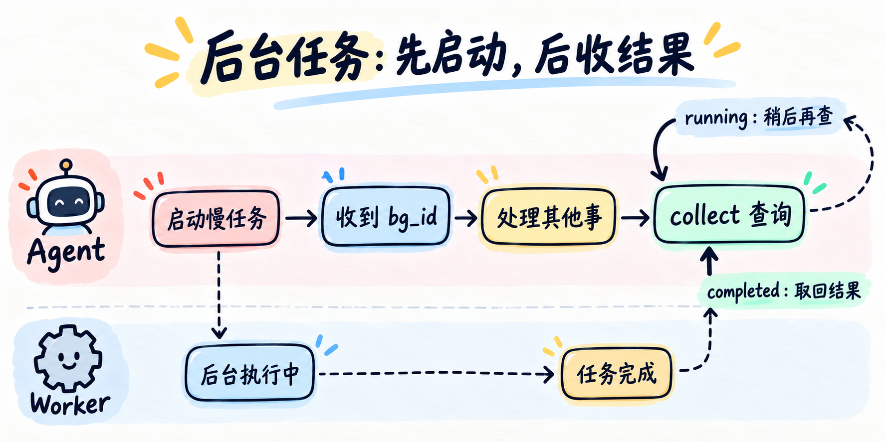

# 第 11 章：Background Tasks —— 慢任务放到后台



> **一句话总结：后台任务让慢操作先返回任务 ID；Agent 可以先做别的事，再主动查询结果。**

第 10 章把任务变成了可追踪的记录，但“任务已经存在”和“任务正在执行”仍然是两回事。

同步调用时，Agent Loop 要等慢工具返回才能往下走。后台调用把这一步拆成两个工具：

- `start_background_job`：交给一个线程去跑，自己立刻返回 `bg_id`（后台任务 ID）；
- `collect_background_jobs`：模型想知道结果时再来问，取走新结束的任务。

worker 跑完不会主动打断模型。结果先留在 Harness（包在模型外面的那层程序）里，等模型来取。

## 跟着跑一遍

```bash
uv run python chapters/11-background-tasks/code.py
```

程序会一直等你输入，空行或 `exit` 退出。先输入：

```text
后台跑 run_demo_tests，延迟 8 秒；同时读一下 chapters/11-background-tasks/README.md 的前 5 行，再查一次后台结果。
```

终端会打印每次工具返回的第一行，大致是这样（模型查得晚的话，第一轮就可能直接看到 `failed`）：

```text
  [tool] start_background_job: 后台任务已启动：bg_2f9bc418（run_demo_tests），status=running
  [tool] read_file: # 第 11 章：Background Tasks —— 慢任务放到后台
  [tool] collect_background_jobs: [仍在运行] bg_2f9bc418 job=run_demo_tests status=running
```

- 启动立刻返回。测试还没开始跑，模型已经拿到了 ID。
- 等待期间模型读了文件，这就是“先做别的事”。
- 查询不阻塞。任务没结束时只返回一行 `[仍在运行] … status=running`，不会替模型等。

等十来秒，再输入：

```text
刚才的后台任务结果怎么样？
```

```text
  [tool] collect_background_jobs: [task_notification] bg_2f9bc418 job=run_demo_tests status=failed exit_code=1
```

模型收到的完整结果里，这一行后面还跟着真实的测试输出：三条 `AssertionError`，最后一行是 `FAILED (failures=3)`。

这是一次真实的失败。`labs/05-verify/demo` 是故意留了 bug 的练习目录，4 个测试挂了 3 个，子进程退出码是 1。如果你在实战 05 里已经把它修好，这里会是 `status=succeeded exit_code=0`。

第二次输入是一轮新对话，模型并不记得 `bg_id`。结果还取得到，是因为任务状态存在 Python 的 `BACKGROUND` 里，不在模型的上下文里。

## 代码里的三个决定

完整代码在 [`code.py`](./code.py)，关键部分是：

```python
JOBS = {
    "check_syntax": {...},    # 解析 chapters/ 和 labs/ 下所有 .py
    "run_demo_tests": {...},  # 跑练习目录的单元测试
}

proc = subprocess.run(JOBS[job]["argv"], shell=False, cwd=WORKDIR,
                      env=child_env(), capture_output=True, timeout=JOB_TIMEOUT)
status = "succeeded" if proc.returncode == 0 else "failed"
```

- **模型只能选名字。** 命令写死在 `JOBS` 里，模型传不进命令字符串。子进程的环境变量里也去掉了 API Key。
- **终态要留下来。** 状态只有 `running`、`succeeded`、`failed`。退出码非 0、超时、子进程起不来，都记成 `failed`，并带上退出码和输出末尾。
- **通知只取一次。** `collect_background_jobs` 取走结果后清空队列，马上再查只会得到 `(没有新的后台结果)`。

`delay_seconds`（0～10，默认 3）是教学用的延迟：线程先等几秒再开跑。这两个任务不到一秒就结束，不加延迟你看不到 `running`。真实的慢任务不需要它。

## 放后台之前要判断什么？

- 适合：构建、测试、等待外部服务等明显耗时，而且 Agent 还有独立工作可做的步骤；
- 不适合：很快就能返回的操作，或后续步骤必须使用它的结果。此时转后台只会增加状态管理和查询成本；
- 面试中要继续追问：结果由谁拉取或推送？任务失败、超时、进程重启后怎么处理？同一任务会不会被重复启动？

第 10 章的 Tasks 记录“要做哪些工作及依赖”；本章记录“一项已启动的慢操作正在运行或已结束”；第 12 章的 Cron 则是在未来某个时间启动工作。三者解决的问题不同。

<details>
<summary>离真实系统还差什么</summary>

- 不持久化。任务状态只在内存里，进程一退出就没了，`bg_id` 也跟着失效。
- 不能取消，也不会重试。
- 通知可能丢。结果被取走后，如果进程在模型处理前退出，不会重发。
- 不清理历史记录。长时间运行的服务要设置保留和清理策略。
- worker 是守护线程，退出程序时不会等它跑完。真实任务应交给可恢复的任务运行器。

</details>

## 一个面试追问

如果 worker 报错，为什么不能只把它从运行列表里删掉？

<details>
<summary>参考思路（先自己想一想，再展开）</summary>

上面的 `run_demo_tests` 就是一次 worker 失败，可以直接观察：模型拿到了 `failed`、退出码 1 和失败的断言，才知道该去看哪个测试。如果只是把任务删掉，模型看到的是“没有新的后台结果”，分不清任务是没跑完、跑成功了还是出了错，也就无法判断该继续、重试还是向用户报告。

所以任务必须留下终态，至少区分成功和失败，并把错误交给 Agent。真实系统还要考虑超时、取消、重试是否安全，以及状态和结果如何持久化。

</details>

## 参考

- [learn-claude-code：s11 Background Tasks](https://github.com/shareAI-lab/learn-claude-code/tree/main/s11_background_tasks)
- [上游中文说明](https://raw.githubusercontent.com/shareAI-lab/learn-claude-code/main/s11_background_tasks/README.zh.md)
