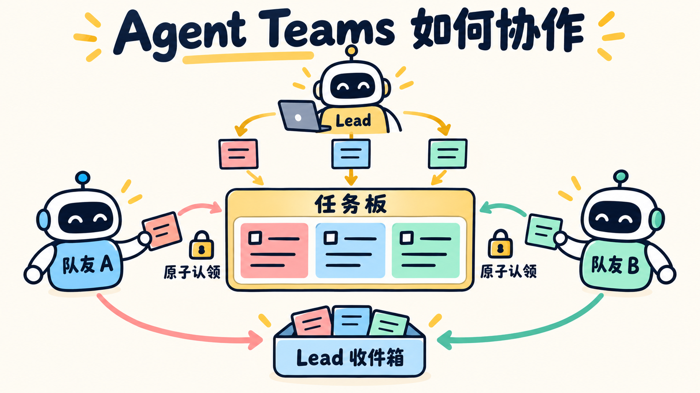

# 第 13 章：Agent Teams —— 多个 Agent 怎样协作



> **一句话总结：Agent Team 是几个各有 `messages` 的 Agent，靠一块共享任务板分工，再把结果经收件箱交回 Lead。**

图里有三样东西。Lead 拆任务、做汇总。队友各领各的任务，各想各的。任务板记着每项任务归谁、做到哪一步，收件箱把结果带回 Lead。队友从不改写 Lead 的对话历史。

按[第 01 章](../01-agent-loop/)的四个问题看，Team 换掉的还是“状态放在哪”：进度放在大家共用的任务板上，每个 Agent 的思考留在自己的 `messages` 里。

第 06 章的 Subagent 是“交出一个子任务，原地等它回来”。Team 是“把几项任务挂到板上，几个队友同时来领”，Lead 不用逐个指派。

## 线程和 Agent 上下文是两回事

| | 回答什么问题 | 本章对应的代码 |
| --- | --- | --- |
| 线程 | 队友怎样同时跑 | 每个队友一条 `threading.Thread` |
| Agent 上下文 | 每个 Agent 知道什么 | 每领一项任务，新建一份 `messages` |

线程让 alice 和 bob 各自等模型返回，不用排队。`messages` 决定谁知道什么：alice 看不到 bob 的任务，也看不到 Lead 和用户聊了什么。

队友领到任务后，在自己的线程里新建上下文，真的调用一次模型：

```python
def run_teammate(name: str, subject: str) -> tuple[str, str]:
    teammate_messages = [
        {"role": "system", "content": f"你是团队成员 {name}，……"},
        {"role": "user", "content": subject},
    ]
    response = client.with_options(
        timeout=TEAMMATE_CALL_TIMEOUT, max_retries=0
    ).chat.completions.create(model=MODEL, messages=teammate_messages)
```

`client` 可以几条线程共用，`messages` 不行。Lead 的那份列表从头到尾没有传进这个函数。

## 跟着一次运行走一遍

先在项目根目录的 `.env` 里填好 `DEEPSEEK_API_KEY`，运行后输入下面这句话：

```bash
uv run python chapters/13-agent-teams/code.py
```

```text
分别用两句话解释 HTTP 缓存、数据库索引和消息队列。建三个任务，交给 alice 和 bob，汇总后关闭团队。
```

1. Lead 调用 `create_team_tasks`，任务板上多出三条 `pending`。
2. Lead 调用 `spawn_teammates`，alice 和 bob 两条线程启动。
3. 每个队友反复做三步：加锁认领一项任务；用自己的 `messages` 调一次模型；把状态写回任务板，把结果发进收件箱。
4. Lead 调用 `collect_team_messages` 收结果，汇总给用户，再调用 `shutdown_team`。

终端会打印认领过程（节选）。两个人各领一项，谁先做完谁领第三项，每次顺序可能不同：

```text
[alice] 认领 team_703674c2：用两句话解释 HTTP 缓存
[bob] 认领 team_90878c68：用两句话解释数据库索引
[alice] team_703674c2 -> completed
[alice] 认领 team_6ae9cee6：用两句话解释消息队列
```

- `collect_team_messages` 最多等 60 秒。模型一次调用可能要好几秒，等得太短只会收到空信箱。超时不算出错，它把任务板状态一起返回，Lead 可以再收一次。
- 收件箱读一次就清空。
- 关闭团队时，没做完的任务仍留在任务板上，Lead 能如实汇报。

## 队友出错了怎么办？

任务有四种状态：`pending` → `in_progress` → `completed` 或 `failed`。

模型调用抛异常、请求超时（上限 30 秒），或 `finish_reason` 不是 `stop`，这项任务都记为 `failed`，收件箱里多一条 `[failed] bob: …` 的消息。本章不重试：`failed` 就是终点，队友接着领下一项，由 Lead 把失败告诉用户。少了 `failed` 会怎样？队友一出错，任务永远停在 `in_progress`。Lead 每次都等到超时，还分不清它是慢还是坏了。

## 认领为什么要加锁？

假如队友先各自读列表，再各自写负责人，两个人就可能同时看到同一条 `pending`。一项任务被做两遍，模型也白调一次。

`TaskBoard.claim_next()` 把“检查状态”和“写入负责人”放进同一把锁，所以一项任务只会被一条线程领走。Python 的 GIL 不能代替这把锁：它不保证“先查后改”这两步中间没有别人插进来。

本章用自己的内存任务板来演示加锁认领；[第 10 章](../10-tasks/)那套存文件的任务记录是另一个例子，这里没有复用。

## 什么时候值得组队？

适合拆开的任务，彼此依赖少，产出边界清楚，还能单独检查。比如分别调查三个互不重叠的模块。任务有严格先后、几个人要改同一个文件，或者最后很难判断对错时，组队只会多花调用、等待和合并的成本。

成本是实打实的：每项任务都是一次模型调用。所以代码设了上限，队友最多 4 个，任务板总共最多 8 项，Lead 自己最多 8 轮，一次运行最多 16 次模型调用。超出时工具返回 `Error`，Lead 想多派也派不出去。

## 本章做到了什么，还缺什么

| 要解决的问题 | 本章怎么做 | 还缺什么 |
| --- | --- | --- |
| 队友怎样干活 | 自己的 `messages`，一次模型调用 | 没有工具，只有一轮，不是完整的 Agent Loop |
| 两个队友会不会领到同一项 | 同一把锁里先查后改 | 多进程要用数据库事务或跨进程锁 |
| 队友出错怎么办 | 记为 `failed`，发失败消息 | 没有租约和重试 |
| 任务板放在哪 | 进程内存 | 重启就丢，需要持久化 |

<details>
<summary>放到生产环境还要补什么</summary>

- **租约**：只有领到任务的队友自己能把它标成 `failed`。它要是卡住不返回，没有别人能接手。常见做法是认领时带过期时间，过期后别人可以重新领。
- **重试和幂等**：重试前要确认同一项任务做两遍不会出事。
- **可靠投递**：收件箱是内存列表，读完即删。Lead 读到后崩溃，结果就没了。
- **验证**：`completed` 只表示队友交了结果，不表示结果是对的。要检查交付物、测试结果或证据。

</details>

## 参考

- [learn-claude-code：s13 Agent Teams](https://github.com/shareAI-lab/learn-claude-code/tree/main/s13_agent_teams)
- [上游中文说明](https://raw.githubusercontent.com/shareAI-lab/learn-claude-code/main/s13_agent_teams/README.zh.md)
