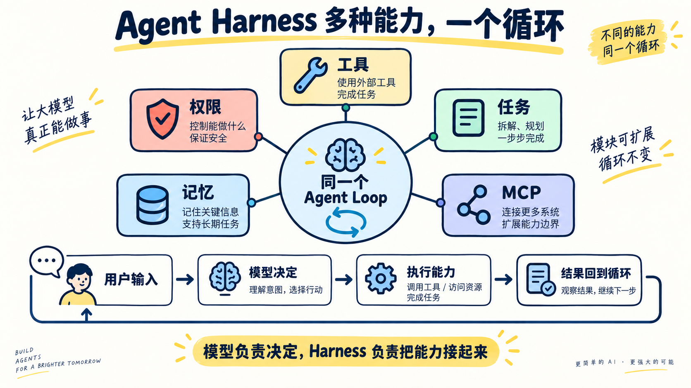

# 第 15 章：Agent Harness —— 能力接入同一个运行循环



> **一句话总结：Agent Loop 决定一轮轮怎么走；Harness 负责为每一轮准备上下文和工具、检查并执行模型提出的调用，再把结果交还给模型。**

Harness（包在模型外面的那层程序）不是某个固定的类名，而是一组职责。前四章各讲了其中一项，本章把它们放进同一个对象。

## Harness 管哪几件事

| 职责 | 之前在哪讲 | 本章代码里的位置 |
| --- | --- | --- |
| 准备上下文：这一轮带给模型什么 | [第 00 章](../00-chat-completion/) | `Harness.system_prompt()` |
| 准备工具清单：这一轮模型能选什么 | [第 02 章](../02-tool-use/) | `Harness.tool_schemas()` |
| 驱动循环：请求模型、回传结果、决定何时停 | [第 01 章](../01-agent-loop/) | `agent_loop()` |
| 检查调用：直接允许、先问用户，还是拒绝 | [第 03 章](../03-permission/) | `Harness.check_permission()` |
| 执行工具，并把失败也变成工具结果 | [第 02 章](../02-tool-use/) | `Harness.dispatch()` |
| 保存状态：哪些东西要比一次请求活得久 | 本章新增 | `Harness` 实例上的字段 |

循环本身和第 01 章一样短。多出来的事情都放进了 Harness，循环只调用它。

## 一次工具调用经过哪些边界

以“把搜索到的结论写进笔记”为例：

1. Harness 按当前状态生成 system prompt 和工具清单；
2. 模型返回普通回答，或提出一个或多个工具调用；
3. Harness 对每个调用做权限判断：`read_file` 直接允许，`write_note` 先把路径和完整内容给你看，`delete_file` 一律拒绝；
4. 通过检查的调用才会执行，结果作为 `tool` 消息回到同一个循环。

这就是第 03 章的 `ALLOW` / `ASK` / `DENY`，只是现在它和工具清单、执行、状态住在同一个对象里。所有调用只有 `dispatch()` 这一个入口，没有第二条路能绕过检查。

## 挂上一项可选能力：以 MCP 为例

主图画了五种能力。本章代码只接了三种：工具、权限，再加一项可选能力 MCP（让 Agent 调用外部服务提供的工具，见[第 14 章](../14-mcp-plugin/)）。

接法很简单。模型调用 `connect_mcp` 后，Harness 记下“已连接”这个状态；下一轮 `tool_schemas()` 的返回值里就多了一个 `mcp__project_docs__search`。循环没有改，权限入口也没有改。

其他可选能力的挂法相同，都是往上表的某一行里加东西：

- [Hooks](../04-hooks/)：在 `dispatch()` 前后留出插口；
- [Context Compact](../08-context-compact/)：请求模型前先整理消息；
- [Memory](../09-memory/) 和 [Tasks](../10-tasks/)：多几个工具，多几项要保存的状态。

记忆和任务在本章代码里没有实现，要看它们怎么工作，请读对应章节。

有两点和第 14 章不同，读代码时别混：

- 第 14 章只给模型两个“元工具”（`list_mcp_tools`、`call_mcp_tool`），工具清单始终很短。本章把外部工具直接放进工具清单，名字带 `mcp__服务名__` 前缀。这样模型用起来和本地工具一样，权限也能按工具名分别判断。两种做法都常见。
- 两章的 MCP Server 都是进程内模拟，没有真实协议。真实的握手和调用见[实战篇 04](../../labs/04-mcp/)。

## 看代码时关注这两处

完整例子在 [`code.py`](./code.py)。

第一处：工具清单每轮重新生成，并且只接受模型这一轮实际看到的工具。

```python
turn_tools = harness.tool_schemas()
offered_tool_names = {tool["function"]["name"] for tool in turn_tools}
response = client.chat.completions.create(..., tools=turn_tools)

# A tool connected in this very batch has to wait for the next turn.
result = harness.dispatch(name, arguments, offered_tool_names)
```

第二处：`dispatch()` 先判断、再确认、最后执行。

```python
decision, reason = self.check_permission(name, arguments, offered_tool_names)
if decision is Decision.DENY:
    return f"Permission denied: {reason}"
if decision is Decision.ASK and not self.confirm(name, arguments):
    return "Permission denied: 用户没有确认"
return str(handlers[name](**arguments))
```

## 运行

```bash
uv run python chapters/15-integrated-harness/code.py
```

程序会一直读取输入，直接回车退出。先输入：

```text
连接项目文档 MCP，搜索 assets，把“图片统一放在哪里”写进 notes/assets.md。
```

你会看到三轮工具调用：连接、搜索、写笔记。写笔记前程序会停下来等你确认。

再输入一句：

```text
再搜一下 ImageGen 相关的约定。
```

这次不用重新连接。每次输入都从一份新的 `messages` 开始，但连接状态存在 Harness 里，所以还在。**要比一次请求活得久的东西，放进 Harness，别指望它留在对话里。**

## 设计检查：刚连接的工具能否在同一轮调用？

模型这一轮收到的工具清单里没有 `mcp__project_docs__search`，却在同一条回复里提出先连接 Server、再搜索。Harness 应该直接执行搜索吗？

<details>
<summary>参考思路</summary>

不应执行。Harness 按本轮发给模型的工具清单校验调用；连接操作只改变后续轮次的能力集合。这样工具发现和工具执行的边界明确，也避免程序状态在一批调用中途变化，意外扩大本轮权限。本章代码会把这次搜索作为 `Permission denied` 交回模型，模型下一轮再调一次就行。

</details>

面试中可以沿着上面那张表追问：工具清单在哪构造？调用在哪授权？副作用在哪里发生？出错和超时怎样回到循环？不要只回答“我写了一个 Harness 类”。

<details>
<summary>这个示例没做什么</summary>

- 状态只在当前进程里，退出就没了；没有数据库，也没有多用户隔离。
- `connect_mcp` 被直接允许，因为它只是进程内登记。连接真实的外部 Server 会启动进程或发起网络请求，应当先问用户。
- 确认只在命令行里问一句，没有审计记录。
- 每次请求都从新的 `messages` 开始，单次请求内也不裁剪上下文。任务很长时需要第 08 章的做法。
- 没有超时、重试和并发控制。

</details>

## 参考

- [learn-claude-code：s15 Integrated Harness](https://github.com/shareAI-lab/learn-claude-code/tree/main/s15_integrated_harness)
- [上游中文说明](https://raw.githubusercontent.com/shareAI-lab/learn-claude-code/main/s15_integrated_harness/README.zh.md)（上游把记忆、任务等能力都接了进来；本章只保留主干和一项可选能力。）
