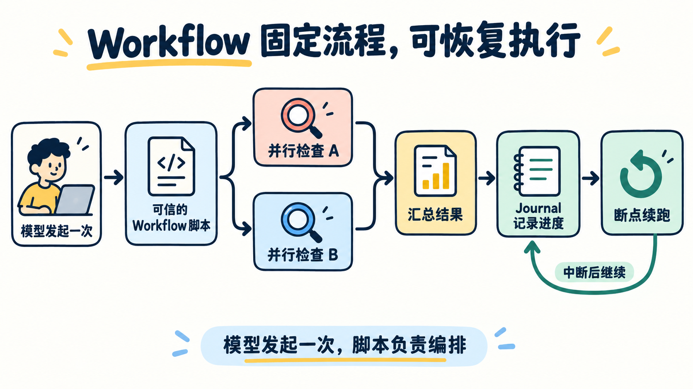

# 第 16 章：Workflow Runtime —— 固定流程，可恢复执行



> **一句话总结：步骤稳定时，把编排写进代码：读什么、先后顺序、哪些并行都由代码定，模型只做其中需要理解内容的几步。**

Agent Loop 适合边看结果边决定下一步。Workflow 适合代码审查、资料汇总这类重复流程：宿主选一段已注册的工作流代码，由它规定步骤、并行边界和汇总时机。

按[第 01 章](../01-agent-loop/)的说法，Workflow 不是另一种 Agent Loop：下一步由代码决定，模型只负责其中的步骤。

## 一次运行里发生了什么

主 Agent 用一次 `run_workflow` 工具调用启动 `review_project`。之后的五步全由 Python 安排，对应图里“可信的 Workflow 脚本”往右的部分：

| 步骤 | 谁来做 | 做什么 |
| --- | --- | --- |
| `gather_structure` | 代码 | 列出根目录、`chapters/`、`labs/`、`assets/` 下的名字 |
| `gather_excerpts` | 代码 | 读三份 README 的开头，每份最多 1500 个字符 |
| `check_concept` | 模型 | 根据摘录，说明 Agent Loop 和 Harness 的关系 |
| `check_structure` | 模型 | 根据目录和摘录，说明 README、章节代码、assets 各管什么 |
| `synthesis` | 模型 | 把两份检查合并成 3 条结论 |

前两步不调用模型。读哪三份文件（根目录、第 01 章、第 15 章的 `README.md`）、读多少，都写死在代码里。模型拿不到工具，也选不了路径。

```python
structure = ctx.step("gather_structure", gather_structure)  # code only, no model call
excerpts = ctx.step("gather_excerpts", gather_excerpts)
findings = ctx.parallel([
    ("check_concept", f"……{grounding}\n\n<材料>\n{excerpts}\n</材料>"),
    ("check_structure", f"……{grounding}\n\n<材料>\n{structure}\n\n{excerpts}\n</材料>"),
])
summary = ctx.agent("synthesis", ...)
```

- 模型步骤的提示词里带着真实材料。`grounding` 要求只依据材料回答，材料里没有的就直说。
- 两个检查互不依赖。`ctx.parallel()` 用线程池同时发出，两个都回来才进入汇总。并行只省等待时间，不会让两个检查共享结论。
- `ctx.agent()` 每次只发一份提示词，不是完整的子 Agent Loop：没有工具，也不继承主 Agent 的对话历史。

## Journal 里记了什么

`Journal`（运行记录）是 `.workflow-runtime/` 下的一个 JSON 文件，文件名就是 `run_id`。里面有工作流名称、版本、原始参数，以及每个已完成步骤的结果。每完成一步就落盘一次。

读到的材料也记了进去。重读一遍很便宜，但模型的回答是看着当时那份材料写的；恢复时文件可能已经改过，重新读盘会让汇总混进“看旧材料”和“看新材料”的两种回答。所以恢复用的是第一次运行时的快照，想分析最新内容就开一次新的运行。判断标准：后面的步骤要用、重来一次又可能不一样的东西，都该进 Journal。

## 恢复时，哪些步骤会重跑？

工作流每次恢复都从入口重新运行。Journal 只让同名且已完成的步骤直接返回旧结果，没完成的步骤才真正执行。

假设第一次运行时 `check_structure` 失败了。带着 `run_id` 恢复，两个收集步骤和 `check_concept` 被跳过，只执行 `check_structure` 和 `synthesis`。原始参数也存在记录里，恢复时以已保存的为准，新传入的参数不生效。

缓存也有边界：步骤名相同，不代表步骤内容一直相同。改了步骤或提示词还复用旧结果，汇总就可能混合新旧逻辑。本例给工作流登记了版本号，版本对不上就拒绝恢复；改动工作流语义时，维护者要把版本加一。

Journal 不保证“恰好执行一次”：一步做完了、结果还没落盘时进程中断，恢复后这一步会再做一遍。

## 跑一个固定工作流

完整代码在 [`code.py`](./code.py)，当前只注册了 `review_project`。Agent 不能提交任意 Python 代码，只能选这个名称并传入参数。

在 `.env` 中填写 `DEEPSEEK_API_KEY`，然后运行：

```bash
uv run python chapters/16-workflow-runtime/code.py
```

输入“运行 review_project 工作流，分析这个项目如何帮助初学者理解 Agent”。三份 README 的开头正好在讲这件事，所以这个问题可以依据材料回答。终端会先打印 `run_id`，成功后工具结果也会带回它。某一步报错或运行中断时，可以让 Agent 带着这个 ID 继续。

## 面试时可以继续追问

哪一部分应固定在 Workflow 代码里，哪一部分应留给模型判断？

<details>
<summary>参考思路</summary>

步骤顺序、读取范围、权限检查、并行边界、重试上限和输出校验通常应由程序明确控制；读懂材料、解释发现或生成摘要可以交给模型。固定流程更容易复现和恢复，代价是版本、缓存失效和副作用重放都要由宿主管理。

</details>

<details>
<summary>离上线还差什么</summary>

- 续跑只靠本地 JSON 和进程内的锁，不支持多个进程同时恢复同一个 `run_id`。
- 没有用户级授权，也没有保留策略：拿到 `run_id` 就能恢复，记录里的文件原文不会自动清理。
- 发信、付款、写入外部系统这类有副作用的步骤，还需要幂等键、去重或补偿机制。

本例展示的是运行时思路，不是可直接上线的工作流服务。

</details>

## 参考

- [learn-claude-code：s16 Workflow Runtime](https://github.com/shareAI-lab/learn-claude-code/tree/main/s16_workflow_runtime)
- [上游中文说明](https://raw.githubusercontent.com/shareAI-lab/learn-claude-code/main/s16_workflow_runtime/README.zh.md)（本项目实现更小，不包含上游运行时的全部能力。）
